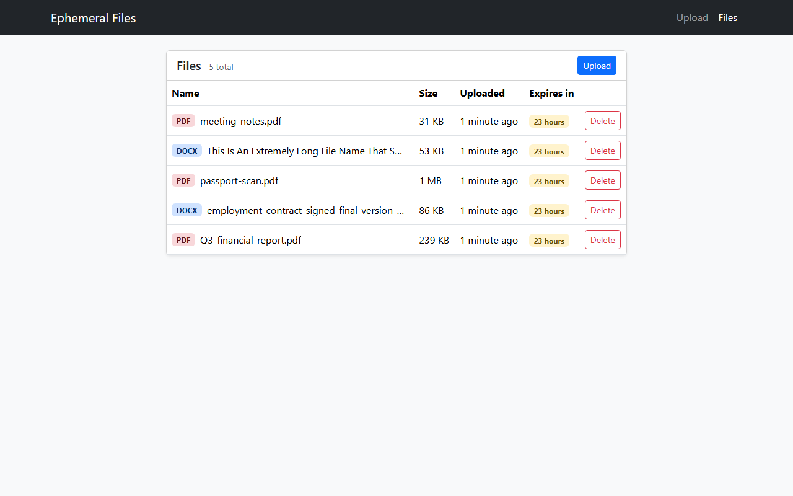
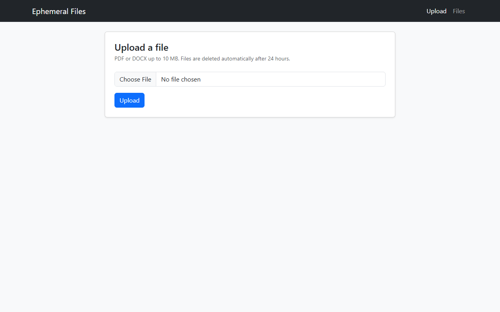
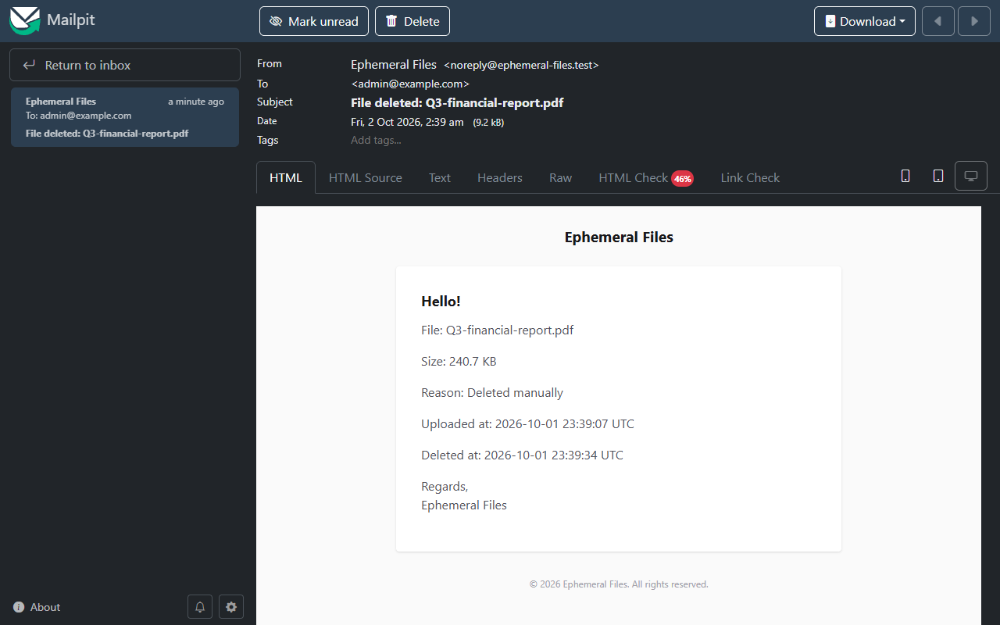

# Ephemeral Files

> The version submitted for the assignment is tagged `submitted`. Later commits are revisions.

[](https://github.com/CaptainAlexxxx/laravel-ephemeral-files/actions/workflows/tests.yml)

Temporary storage for PDF and DOCX files. Every file is deleted 24 hours after upload, and every deletion, manual or automatic, sends an email notice through RabbitMQ.

Laravel 13, PHP 8.4, MySQL 8.4, RabbitMQ 3, Bootstrap 5 + jQuery, Docker Compose.



## Run it

Needs Docker with Compose v2, nothing else.

```bash
cp .env.example .env
docker compose up -d
```

The first start installs dependencies and runs migrations in the container, about 5 minutes on a cold machine. `docker compose ps` shows `app` as `healthy` when it is ready.

| What | URL |
|---|---|
| Upload page | http://localhost:8080 |
| File management | http://localhost:8080/files |
| RabbitMQ management | http://localhost:15672 (guest / guest) |
| Mailpit (caught emails) | http://localhost:8025 |

On Linux with a user id other than 1000, set `UID` and `GID` in `.env` (`id -u`, `id -g`) before the first start. Ports are bound to `127.0.0.1`; change `APP_PORT` if 8080 is taken.

## How to check it

1. Upload a PDF or DOCX at http://localhost:8080. A file over 10 MB, or a text file renamed to `.pdf`, gets a validation error.
2. Open `/files`, delete the file, then open Mailpit: there is a "deleted manually" email to `NOTIFY_EMAIL`.
3. Automatic deletion without waiting a day: set `FILE_TTL_MINUTES=1` in `.env` (read on every request, no restart), upload, wait about two minutes. The scheduler purges every minute and Mailpit gets an "expired" email. Run the purge by hand with `docker compose exec app php artisan files:purge-expired`.
4. The message in RabbitMQ: `docker compose stop queue-worker`, delete a file, wait up to a minute. The `default` queue at http://localhost:15672/#/queues holds one message and Mailpit gets nothing. `docker compose start queue-worker` and the email arrives.
5. An unpublished notice: `docker compose stop scheduler`, delete a file, then
   `docker compose exec mysql mysql -uephemeral_files -ppassword ephemeral_files -e "select id, original_name, published_at from deletion_notices"`
   shows `published_at` empty until `docker compose exec app php artisan notices:publish` (or the scheduler) sends it.

| Upload | Deletion notice |
|---|---|
|  |  |

## Tests

```bash
docker compose exec app php artisan test
docker compose exec app ./vendor/bin/pint --test
```

Tests run on SQLite in memory (CI runs them on MySQL 8.4) with notifications faked, so no broker is needed. Fixtures are real files, because Laravel's `UploadedFile::fake()` takes the mime type from the file name and would make the content checks pass whatever the bytes are. Covered: upload validation (10 MB boundary, content vs extension, DOCX detection), both deletion paths, the TTL boundary, purge idempotency, the outbox (broker down, bad rows, retention), rate limits, the mail text.

Two tests need real InnoDB row locks and are skipped on SQLite: a second process races a delete on the same row, and two `notices:publish` processes claim the same notice. To run them, export all six variables below (`phpunit.xml` only sets SQLite when they are not already set; the test processes inherit them) and use an empty database of its own, because the tests migrate and truncate it. The user needs `performance_schema` access, root has it.

```bash
docker compose exec mysql mysql -uroot -proot-password -e "create database if not exists ephemeral_files_test"
docker compose exec \
  -e DB_CONNECTION=mysql -e DB_HOST=mysql -e DB_PORT=3306 \
  -e DB_DATABASE=ephemeral_files_test -e DB_USERNAME=root -e DB_PASSWORD=root-password \
  app php artisan test
```

Without Docker, set the same six variables for a MySQL 8 on `127.0.0.1`; the PHP CLI needs `pdo_mysql`.

## How it works

```
upload    browser --AJAX--> FileController@store --> FileUploadService --> private disk + stored_files row

manual    browser --AJAX--> FileController@destroy --.
                                                     |--> FileDeletionService --> deletion_notices row (same transaction)
expired   scheduler --> files:purge-expired ---------'

notice    scheduler --> notices:publish --> RabbitMQ --> queue-worker --> mail (Mailpit)
```

Services: `app` (php-fpm), `nginx`, `mysql`, `rabbitmq`, `queue-worker`, `scheduler` (purge every minute, notice publisher every minute, `model:prune` daily), `mailpit`.

Decisions (rejected alternatives are in [docs/TASK.md](docs/TASK.md), the step plan in [docs/PLAN.md](docs/PLAN.md)):

- **One deletion path.** The controller and the purge command both call `FileDeletionService::delete()`.
- **Sweep, not delayed jobs.** `expires_at` is stored on upload and a command runs every minute. A job delayed by 24 hours is lost if the queue is purged and is hard to test. A file goes within a minute of its expiry.
- **Transactional outbox.** The delete and a `deletion_notices` row commit together, and the recipient is stored on the row. `notices:publish` pushes unpublished rows to RabbitMQ and sets `published_at`. A broker outage delays the email but never fails the delete. Publishing inside the transaction is a dual write, publishing after commit loses the notice when the broker is down.
- **One notice per file.** The delete is a conditional `DELETE ... WHERE id = ?`: the loser of a manual-vs-purge race waits on the row lock, deletes 0 rows and writes no notice.
- **At-least-once delivery.** Each row is claimed with `FOR UPDATE SKIP LOCKED`, so overlapping publishers do not double-send. A crash between the push and `published_at` means a duplicate email, not a missing one. The broker push runs under the lock of the outbox row only, which no user request waits on. The queue driver has no publisher confirms, so a loss after the broker accepted a message is theoretically possible; a job that keeps failing in the worker lands in `failed_jobs` (retry with `php artisan queue:retry all`).
- **Bad rows do not block the rest.** A row that fails for its own reason (not a DB or broker error) gets `attempts` incremented and is logged; after `NOTICE_MAX_ATTEMPTS` (5) it is skipped. Broker and DB errors stop the run and the next one retries.
- **Notices expire too.** A published row keeps the original file name, so `model:prune` deletes it after `NOTICE_RETENTION_DAYS` (7). Unpublished rows are never pruned.
- **Content decides the file type.** The detected type must be PDF or DOCX and match the extension. Files live on a private disk under UUID names; original names are only displayed, escaped.
- **Limits.** Laravel rejects over 10 MB (nginx and PHP allow 12 MB, nginx answers 413 above that). Upload is throttled to 20 and delete to 30 requests per minute per IP.
- **Simple on purpose.** Facades instead of injected contracts, no interfaces with one implementation, hard deletes (the email keeps name, size, reason and times). `.env.example` has `APP_DEBUG=true` and `guest/guest` so the stack starts with one command.

## Known limits

- No authentication: anyone who can open the app can upload and delete. The task does not mention users.
- If the process dies after the delete commits but before the file is removed from disk, the file stays on disk without a row. An orphan cleanup would fix it.

## How AI was used

Built with Claude Code. I planned and reviewed every diff, agents wrote the code, separate QA and reviewer agents checked it. Prompts, agent roles, findings and the places where the AI was wrong are in [AI_PROMPTS.md](AI_PROMPTS.md).
